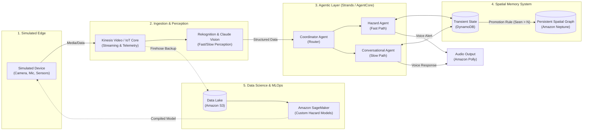

# Lumen


Lumen is an ambient AI companion designed for blind and low-vision users. Built entirely on AWS, it processes live camera and audio feeds using serverless and streaming technologies to provide real-time spatial awareness, hazard detection, and scene understanding. The system utilizes a multi-agent orchestration architecture via the Strands Agents SDK and Amazon Bedrock, backed by a persistent graph-based spatial memory on Amazon Neptune to build a continuous, reliable understanding of a user's environment.

## High-Level Architecture Overview

This diagram represents the foundational, high-level data flow for Phase 1. As the project matures, this will be expanded in `/docs/ARCHITECTURE.md` to include granular MLOps pipelines, detailed CI/CD workflows, and robust Observability layers.



## Table of Contents

- [Month 1: AWS Cloud Foundations](#month-1-aws-cloud-foundations)
- [Month 2: Generative AI & Agents](#month-2-generative-ai--agents)
- [Month 3: Data Engineering Core](#month-3-data-engineering-core)
- [Month 4: Perception, Memory & Agent Deployment](#month-4-perception-memory--agent-deployment)
- [Month 5: DevOps, Containers & IaC](#month-5-devops-containers--iac)
- [Month 6: Advanced ML & Observability](#month-6-advanced-ml--observability)

---

### Month 1: AWS Cloud Foundations
Focuses on core cloud infrastructure including IAM, VPC, EC2, S3, DynamoDB, and Lambda. Sets the baseline for secure, scalable serverless development.

### Month 2: Generative AI & Agents
Introduces Amazon Bedrock, prompt engineering, Retrieval-Augmented Generation (RAG), and multi-agent systems using the Strands Agents SDK.

### Month 3: Data Engineering Core
Builds the data ingestion backbone using S3 Data Lakes, AWS Glue (ETL & Catalog), Amazon Kinesis (Video & Data Streams), and IoT Core for simulated device telemetry.

### Month 4: Perception, Memory & Agent Deployment
Implements the fast/slow processing paths utilizing Amazon Rekognition and Claude Vision, supported by transient memory in DynamoDB and a permanent spatial knowledge graph in Amazon Neptune. Agents are deployed using Amazon Bedrock AgentCore.

### Month 5: DevOps, Containers & IaC
Expands the project to production-grade engineering standards with Docker, Kubernetes (Helm, Ingress, HPA), CI/CD pipelines (GitHub Actions, CodePipeline), and Infrastructure as Code (Terraform, AWS CDK).

### Month 6: Advanced ML & Observability
Wraps up Phase 1 by implementing custom hazard-detection models via Amazon SageMaker (training, tuning, Model Registry, Neo), Human-in-the-Loop workflows (A2I), and comprehensive Site Reliability Engineering (SRE) practices utilizing CloudWatch, X-Ray, Prometheus, and Grafana.

---

## Repository Structure

```text
lumen/
├── .github/             # CI/CD pipelines (GitHub Actions, Trivy)
├── docs/                # Architecture, design docs, and weekly retrospectives
├── infra/               # Infrastructure as Code (Terraform / AWS CDK)
├── src/                 # Application source code (agents, ETL, perception logic)
├── tests/               # Test suites (pytest, Locust load tests)
├── CHANGELOG.md         # Version history
├── CODE_OF_CONDUCT.md   # Community guidelines
├── CONTRIBUTING.md      # Setup and contribution workflow
├── LICENSE              # MIT License
├── README.md            # Project overview
└── SECURITY.md          # Vulnerability reporting guidelines
```

## Getting Started

*(Detailed local setup instructions, Python virtual environment configuration, and `pre-commit` hooks will be documented as the codebase is initialized in Week 4).*

Please refer to [`CONTRIBUTING.md`](CONTRIBUTING.md) for current repository guidelines and commit standards.

## Documentation Index

Detailed design decisions and architectural choices are recorded in the `/docs` directory as the project evolves:

* [ ] [`docs/ARCHITECTURE.md`](docs/ARCHITECTURE.md) — Full System Architecture Details
* [ ] `docs/rag-notes.md` — RAG & Chunking Strategy
* [ ] `docs/data-lake-design.md` — S3 Zones, Partitioning & Lake Formation
* [ ] `docs/streaming-design.md` — Kinesis Hot/Durable Paths
* [ ] `docs/perception-eval.md` — Fast/Slow Path & Multimodal Evaluation Matrix
* [ ] `docs/memory-design.md` — DynamoDB Access Patterns & Neptune Promotion Logic
* [ ] `docs/cicd-design.md` — GitHub Actions OIDC & CodePipeline Architecture
* [ ] `docs/infra-design.md` — IaC Modules, Remote State & Drift Detection
* [ ] `docs/ml-design.md` — SageMaker Pipeline, MLflow & Drift Monitoring
* [ ] `docs/safety-design.md` — Guardrails, Confidence Thresholds & A2I Escalation
* [ ] `docs/observability-design.md` — SLOs, Error Budgets, Prometheus/Grafana & Chaos Testing

## License

This project is licensed under the MIT License — see the [`LICENSE`](LICENSE) file for details.